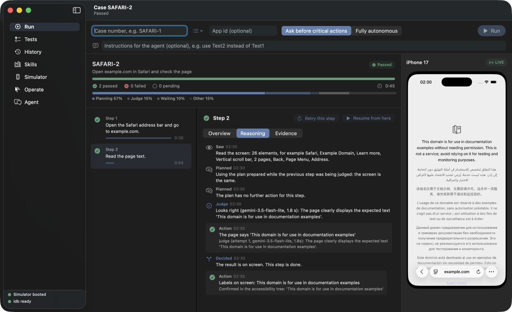
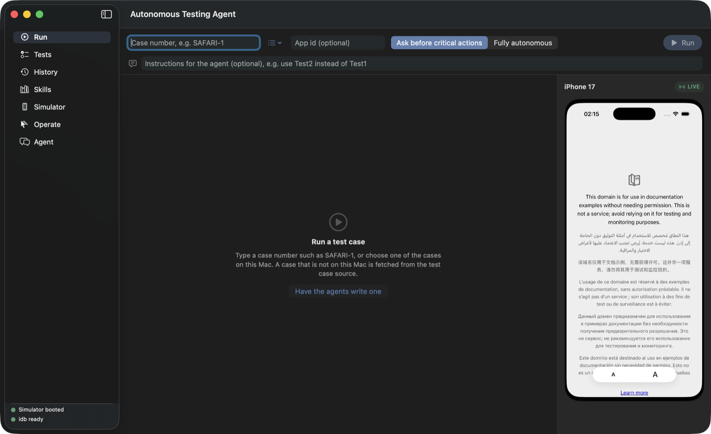
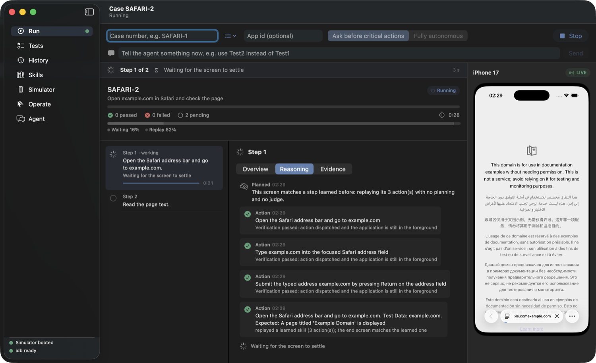
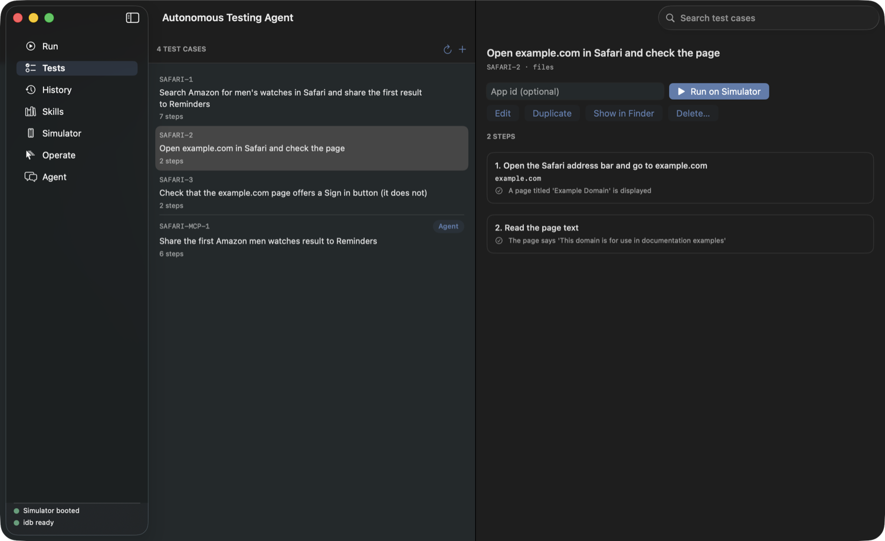
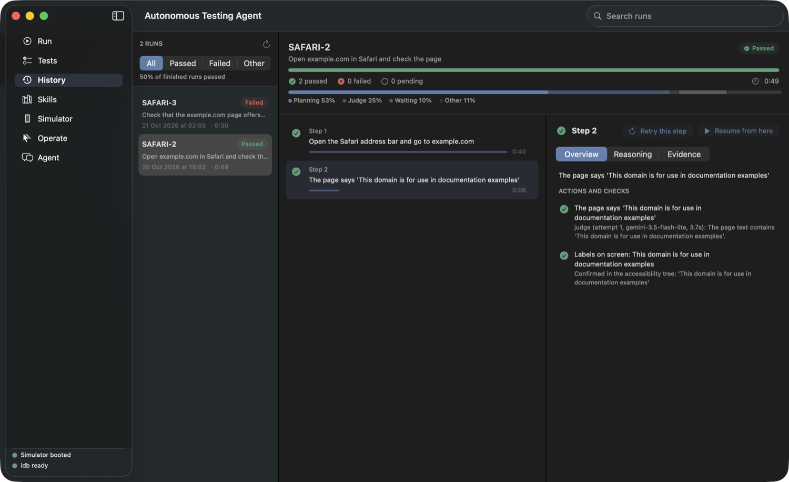
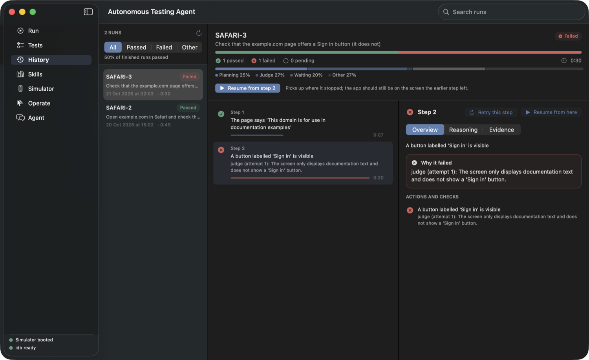
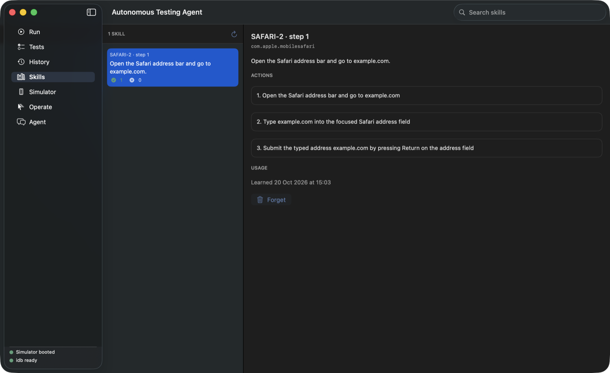
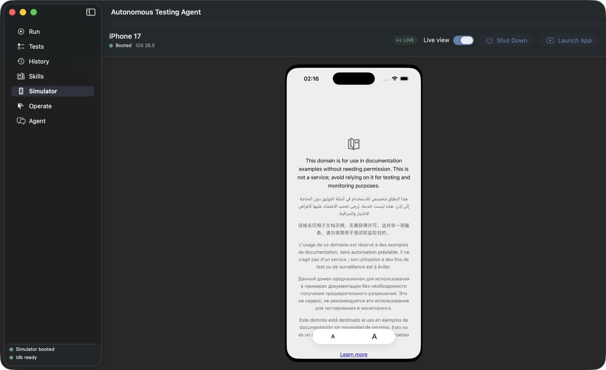
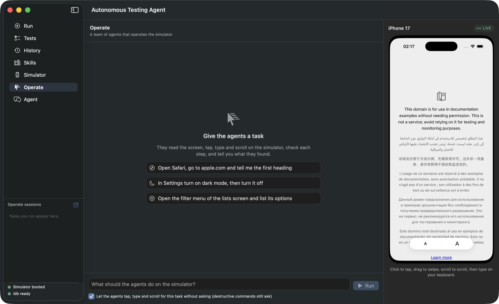

# Autonomous Testing Agent

Runs test cases on an iOS simulator by itself. You write a test case in plain language ("open example.com, check the page says…"); an LLM turns each
step into actions, they are checked and executed through [idb](https://fbidb.io), and a vision model judges the screen afterwards. A person is asked only
when needed: credentials, and critical actions such as deleting data.

It comes as a **macOS app**, a **command line tool**, and an **MCP server** and **skill**, so Claude Code, Codex, Cursor and other AI tools can drive the
simulator and run your cases too.

<p align="center"></p>

```
test case ──► LLM plan ──► validate ──► approve ──► execute (idb) ──► judge ──► report
 files · AIO   grounded on   trusted     human or     simulator       screenshot   pass/fail per step,
 · by hand     the live      spine       policy                       + checks     screenshots, timing
               screen
```

## Contents

[What you get](#what-you-get) · [Quick start](#quick-start) · [Tour of the app](#tour-of-the-app) · [Configuration](#configuration) ·
[Write a test case](#write-a-test-case) · [Run a case](#run-a-case) · [How a step runs](#how-a-step-runs) · [Safety](#safety) ·
[Use it from AI tools](#use-it-from-ai-tools-mcp-cli-skill) · [CI](#continuous-integration) · [Agent chat](#agent-chat) · [Project layout](#project-layout) ·
[Troubleshooting](#troubleshooting) · [Development](#development)

## What you get

- **Plain-language cases** as JSON files (`TestCases/KEY.json`), fetched from AIO Tests, or drafted from Gherkin or a story (`generate_cases`).
- **A judge that looks at the screen** and the accessibility tree, so a step passes because the result is really there.
- **Learned skills**: a step that worked is replayed next time with no planning and no judge call.
- **A macOS app** to run a case and watch it live, browse and edit cases, filter past runs and see where each step's time went, a live simulator view,
  a Cmd+K command palette, and an agent chat that writes cases from your app's source.
- **Safety by design**: every action goes through validation and approval; destructive commands need an explicit confirmation; passwords never reach a
  case, a report or a prompt.
- **Integrations**: an MCP server (tools, prompts, and the cases and runs as resources; stdio or local HTTP), a CLI with JSON output, JUnit XML for CI.

## Quick start

**Requirements**: macOS with Xcode 26 (Swift 6.3), a booted iPhone simulator, idb, and a model key (Gemini or DeepSeek).

```bash
# 1. idb: the companion (Homebrew) and the client (a Python venv inside the project)
brew install facebook/fb/idb-companion
python3 -m venv .venv-idb && .venv-idb/bin/pip install fb-idb

# 2. Keys: copy the example and fill in what you use
cp .env.example .env            # then edit .env (see "Configuration")

# 3. Build
swift build

# 4. Boot a simulator and run the example case (it opens example.com in Safari and checks the page)
xcrun simctl boot "iPhone 17"   # skip if one is already booted
BIN=$(swift build --show-bin-path)
$BIN/AutonomousTestingAgent --run-case=SAFARI-2 --bundle-id=com.apple.mobilesafari --mode=LIVE_AUTONOMOUS_AFTER_LOGIN
```

You see each step planned and executed, then the judge's verdict and `CASE RUN PASSED: SAFARI-2` (about 45 seconds the first time). The report and
screenshots are saved under `.runs/cases/`. Open the app to browse them:

```bash
$BIN/AutonomousTestingAgentApp          # or: swift run AutonomousTestingAgentApp
```

## Tour of the app

The window has a sidebar of seven sections, `Cmd+1` to `Cmd+7`, and a status line showing whether the simulator is booted and idb is ready. Press
`Cmd+K` anywhere for the command palette: jump to a section, run a case by name, open a past run, or stop the running case.

Everything below was captured from a real run of the example cases in `TestCases/`.

### Run

Type a case number (or pick one from the list next to it), optionally an app id, choose **Ask before critical actions** or **Fully autonomous**, and press Run.
Until idb, a booted simulator and a model key are all in place, this screen shows a checklist of what is missing instead.

<p align="center"></p>

While it runs you see the step in progress, what the runner is waiting for, the time split (planning, judge, waiting, replay), the reasoning of each step
as it happens, and the device live on the right. You can type an instruction mid-run ("use Test2 instead of Test1"); it is remembered for that case.
Here the second run replays a learned skill, so step 1 needs no planning:

<p align="center"></p>

When it finishes, each step shows how long it took (the bar is its share of the slowest step), and the **Reasoning** tab tells what the agent saw, planned,
did, and how the judge decided. **Retry this step** and **Resume from here** continue a run without starting over.

### Tests

The cases on this Mac: yours in `TestCases/`, and any fetched from AIO. Select one to read its steps (action, test data, expected result), edit it,
duplicate it, reveal it in Finder, delete it, or run it. **+** creates a new one.

<p align="center"></p>

### History

Every finished run, newest first, with an outcome filter (All, Passed, Failed, Other), a search box, and the share of finished runs that passed.
A run that was killed before it could write its end is labelled *Interrupted*. Select a run to see its steps, timing, reasoning and the screenshot taken for each step.

<p align="center"></p>

A failed run says why, in plain words, on the step that failed (here the judge could not find a button the case expected), and you can resume from that step:

<p align="center"></p>

### Skills

When a step passes, the actions that worked are saved as a skill for that app and screen. The next time the same screen and step come up, they are
replayed directly, which is faster and uses no model calls. Skills that stop working are dropped; **Forget** removes one by hand.

<p align="center"></p>

### Simulator

The live picture of the booted device. Click to tap, drag to swipe, scroll to scroll, and type on your keyboard. You can boot or shut down the device and
launch an app from here, and show the picture docked, in the real Simulator window, or hidden.

<p align="center"></p>

### Operate

Give a team of agents a task in plain words ("open Safari, go to apple.com and tell me the first heading"). They read the screen, tap, type and scroll on the
simulator, check each step and report what they found. It is for exploring an app or doing a one-off job; use a test case when you want a repeatable check.
Taps and typing for the task can be pre-approved with the checkbox; destructive commands still ask.

<p align="center"></p>

### Agent and Settings

**Agent** is a chat with a team of agents that reads one of your repositories and writes test cases from it (see [Agent chat](#agent-chat)).
**Settings** (`Cmd+,`) has an *Agents* tab (repository, model provider, agent flow) and a *Connections* tab that shows what is ready and gives you the command
that connects Claude Code to this project over MCP.

## Configuration

Settings come from the environment or a `.env` file in the project root (real environment variables win). [.env.example](.env.example) lists all of them:

| Variable | What it is for |
|---|---|
| `GEMINI_API_KEY` | The screenshot judge and Gemini planner. Without any model key a case cannot be planned or judged. |
| `DEEPSEEK_API_KEY` | The planner for the case runner and the agent team (the default provider). |
| `AIO_API_KEY`, `AIO_PROJECT`, `AIO_BASE_URL` | Only to fetch cases by number from AIO Tests. Hand-written cases need none of them. |
| `TEST_USER_USERNAME`, `TEST_USER_PASSWORD` | The login used by cases with a login step. Read at run time; never written anywhere. |
| `ATA_IDB_PATH` | idb, when it is not in `.venv-idb`, `/opt/homebrew/bin` or `/usr/local/bin`. |
| `ATA_PROJECT_ROOT` | The project whose `TestCases/` and `.runs/` are used (default: the current folder). |
| `ATA_USER_WAIT_SECONDS` | How long a run waits for you (a login, a code, an approval) before it stops. Default 600. |
| `ATA_LOG_LEVEL`, `ATA_LOG_CONSOLE`, `ATA_LOG_FILE` | Logging. |
| `ATA_MCP_TOKEN` | Bearer token for `ata-mcp --http=<port>`. |

`.env` is git-ignored. Never commit keys.

## Write a test case

A case is a JSON file in `TestCases/`. Each step is plain language: an action, optional test data, and what the screen shows when it worked. Quote the
exact labels you expect: the judge and a quick accessibility-tree check both look for them.

```json
{
  "key": "SAFARI-2",
  "title": "Open example.com in Safari and check the page",
  "source": "files",
  "steps": [
    { "number": 1, "action": "Open the Safari address bar and go to example.com", "data": "example.com",
      "expected": "A page titled 'Example Domain' is displayed" },
    { "number": 2, "action": "Read the page text", "data": "",
      "expected": "The page says 'This domain is for use in documentation examples'" }
  ]
}
```

Ways to create one:

- **By hand**, in the **Tests** section (+) or as a file.
- **From your app's source**, with the agent team in the **Agent** section.
- **From a requirement**, with the `generate_cases` tool: Gherkin scenarios, or a story whose acceptance criteria are a list. It previews by default and
  writes `PREFIX-1`, `PREFIX-2`… when asked; the drafts are starting points to refine with real labels.

A password is never written into a case: use `[CREDENTIALS]` where one is typed. Other examples in the repository: `SAFARI-1` (a longer flow in Safari and
Reminders), and `SAFARI-3`, which **fails on purpose** (it looks for a Sign in button that example.com does not have), useful for seeing a failed run.

## Run a case

```bash
$BIN/AutonomousTestingAgent --run-case=SAFARI-2 --bundle-id=com.apple.mobilesafari --mode=LIVE_AUTONOMOUS_AFTER_LOGIN
```

| Flag | Meaning |
|---|---|
| `--bundle-id=ID` | The app under test; default Safari. |
| `--mode=` | `LIVE_AUTONOMOUS_AFTER_LOGIN` (a person approves destructive steps) or `NON_LIVE_TEST`. |
| `--start-step=N`, `--end-step=N`, `--skip-steps=8,12` | Run part of a case. |
| `--username=NAME` | The username for the login step. |
| `--skills=off`, `--judge=off` | Turn off skill replay, or the screenshot judge. |
| `--allow-destructive` | Allow steps that delete or log out. |
| `--refresh` | Fetch the case again instead of using the cached copy. |
| `--max-consecutive-failures=N` | Stop after N failed steps in a row. |
| `--events` | JSON lines for another program (the app uses this). |
| `--plan-tests [--root=DIR] [--base=REF]` | Plan tests from a code change without touching a device. |

## How a step runs

1. **Replay or plan.** If a learned skill matches the screen, its actions are replayed. Otherwise the model reads the live screen (the accessibility tree)
   and plans actions grounded on elements that exist; a plan that names an element that is not there is regenerated.
2. **Validate and approve.** Each action goes through validation, then approval by policy (or by you, for critical ones) before it is dispatched.
3. **Execute** through idb: tap, type, swipe, scroll, launch, and so on, with the app kept in the foreground.
4. **Check.** A quick accessibility-tree check confirms quoted labels; a vision model judges the screenshot against the expected result. A failed judge
   triggers a retry with what it saw.
5. **Report.** Each step's result, reasoning, screenshot and timing is written to `.runs/cases/`, and a passing step becomes a skill.

## Safety

- Every action goes through proposal, validation, approval and authorization before it runs; nothing the model says is executed directly.
- Destructive commands (uninstall, erase, log out, delete) are refused unless a person confirms them.
- Passwords come from the environment at run time. They are never written to a case, report, log or prompt, and outputs are redacted.
- The agent team reads a repository read-only and never sees `.env` files or keys.
- The MCP HTTP transport listens on the loopback address only, needs a bearer token, and refuses cross-site browser requests.

## Use it from AI tools (MCP, CLI, skill)

Claude Code, Codex, Cursor and other agents can observe the simulator, tap, type, read and write cases and run them.

```bash
Scripts/install.sh                                   # builds release binaries and links ata and ata-mcp into ~/.local/bin
claude mcp add autonomous-testing-agent -- ata-mcp --project-root=$PWD
```

- **Tools**: device control (observe, input, apps, files), `list_cases`, `read_case`, `write_case`, `generate_cases`, `run_case`, `list_runs`,
  `get_report`, `plan_tests`.
- **Prompts**: `write_case`, `triage_failure` and `plan_for_diff`, shown as slash commands in clients that support them.
- **Resources**: every case as `ata://case/<KEY>` and recent runs as `ata://run/<id>` (and `…/junit`), which clients let you attach with `@`.
- **HTTP**: `ata-mcp --http=8765` serves the same tools at `http://127.0.0.1:8765/mcp` on this machine only (bearer token required).
- **CLI**: `AutonomousTestingAgent tool list`, `tool describe <tool>`, `tool call <tool> '<json>'`; output is JSON.

Setup for each client, the safety model and troubleshooting: [docs/INTEGRATIONS.md](docs/INTEGRATIONS.md). The skill that teaches an agent the observe, act, check
loop is in `skills/autonomous-testing-agent/`.

## Continuous integration

`get_report` with `format=junit` returns JUnit XML (one testsuite per run, one testcase per step) that GitHub Actions, Jenkins and GitLab show as test results:

```bash
$BIN/AutonomousTestingAgent tool call get_report '{"format":"junit"}' | jq -r '.content[0].text' > results.xml   # latest run of each case
```

`.github/workflows/ci.yml` builds and runs the unit tests. Running real cases needs a macOS runner with a simulator, idb and a model key.

## Agent chat

The Agent section takes a test scenario in plain language. A team of agents (Orchestrator, RepoAnalyst, CaseAuthor, Runner, Validator) reads a local
repository, uses CodeIntelligence to understand it, writes `TestCases/<KEY>.json`, runs it after you approve, and judges the result. Their reasoning,
tool calls and hand-offs stream into the chat. Set the repository in **Settings** (`Cmd+,`) or with the folder button above the chat; it is only ever read.
The chat remembers earlier turns, per repository, so "continue" works after Stop or a restart.

```bash
$BIN/AutonomousTestingAgent --agent --events --repo=/path/to/repo [--provider=deepseek|gemini] [--model=<name>]
```

## Project layout

| Path | What it is |
|---|---|
| `Sources/TestCaseSources` | Where test cases come from: the neutral `TestCase` model, the file source, the AIO client and `StoryDrafter`. |
| `Sources/AgentCore` | The core, depending on nothing: domain model, security (approval, authorization), the trusted execution spine, application logic and the ports it needs. No I/O, no UI. |
| `Sources/AgentInfrastructure` | Adapters: the idb driver and device control, the model APIs, files and persistence, logging, simulator control. |
| `Sources/AgentEngine` | The work the tool does: the case runner, the agent team, the Operate graph, and the entry points. |
| `Sources/AgentPresentation` | Observable view-models for the app. It sees the core only, never an adapter. |
| `Sources/AgentComposition` | `AppCompositionRoot`: builds the real adapters and hands them to the view-models. |
| `Sources/AgentGateway` | The tool layer other agents call: one catalogue used by the MCP server and the CLI. |
| `Sources/AgentMCP`, `Sources/MCP` | The MCP server (stdio and local HTTP) and its executable `ata-mcp`. |
| `Sources/CLI` | The command line tool `AutonomousTestingAgent`. |
| `Sources/GUI` | The macOS app. Views and design system only; it starts the CLI and shows its events. |
| `Sources/CodeIntelligence` | Static analysis used to plan tests from code changes. |
| `TestCases/` | Example and hand-written test cases (`<KEY>.json`). |
| `Fixtures/` | A small iOS fixture app used for tests. |
| `skills/` | The skill that teaches other agents to use the tools. |
| `docs/` | Integrations, architecture, contributing guide. Start with `ARCHITECTURE.md` and `ARCHITECTURE_RULES.md`. |
| `.runs/`, `.skills/` | Run reports with screenshots, and learned step skills (git-ignored). |

## Troubleshooting

- **"idb is not installed"**: install it as in Quick start, or point `ATA_IDB_PATH` at your `idb`.
- **The app shows another project's runs or cases**: the app and CLI use `ATA_PROJECT_ROOT` if set, else the current folder when it has `TestCases/` or a `.env`, else the nearest Swift package above it. Start them from your project folder or set `ATA_PROJECT_ROOT`.
- **Every screenshot fails but taps work**: the idb companion for the simulator has gone stale after days of running. Screenshots fall back to
  `xcrun simctl` automatically; to reset the companion, quit it (`pkill -9 idb_companion`) and delete `/tmp/idb/<udid>_companion.sock`; it restarts on the next call.
- **A run waits and does nothing**: it may be waiting for you (a login, a code, an approval). The app badges the Dock icon; the wait ends after `ATA_USER_WAIT_SECONDS`.
- **A page did not load in Safari**: the simulator needs network access; open the URL in the simulator's Safari by hand to check.
- **Slow steps**: set `ATA_TRACE=/tmp/idb-trace.txt` to log how long each idb call took.

## Development

```bash
swift build
swift test --no-parallel
```

Where code goes and the module rules are in [docs/CONTRIBUTING.md](docs/CONTRIBUTING.md), `ARCHITECTURE.md` and `ARCHITECTURE_RULES.md`; architecture tests enforce them.
The tool catalogue is `Sources/AgentGateway`, and `skills/autonomous-testing-agent/references/tools.md` is generated from it
(`AutonomousTestingAgent tool list --markdown`); a test fails when it is stale.

The app has debug-only flags for capturing screenshots (`--snapshot=PATH --tab=History --history-select=RUN_ID --tests-select=KEY --run-case=KEY`); see
`Sources/GUI/App/Harness/LaunchHarness.swift`. CI (`.github/workflows/ci.yml`) builds and runs the unit tests.
